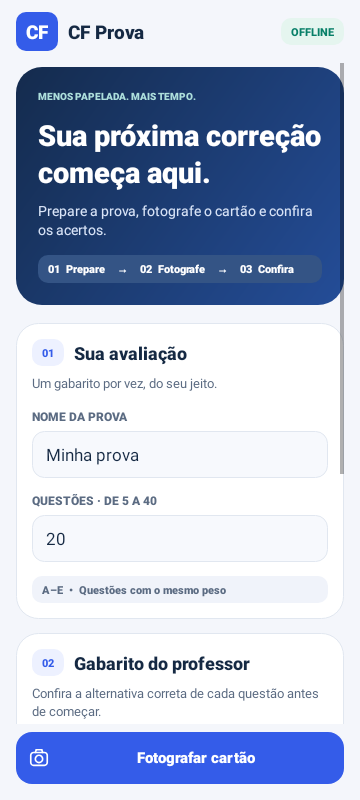
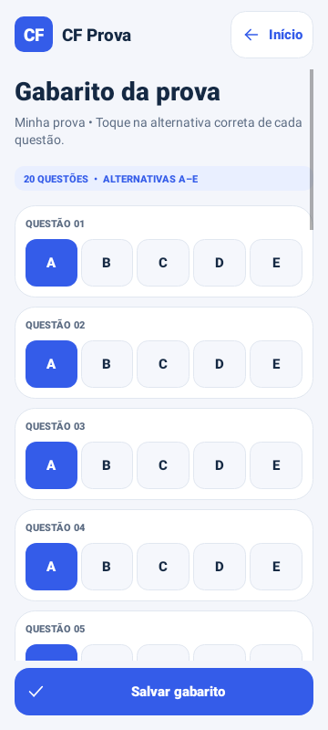
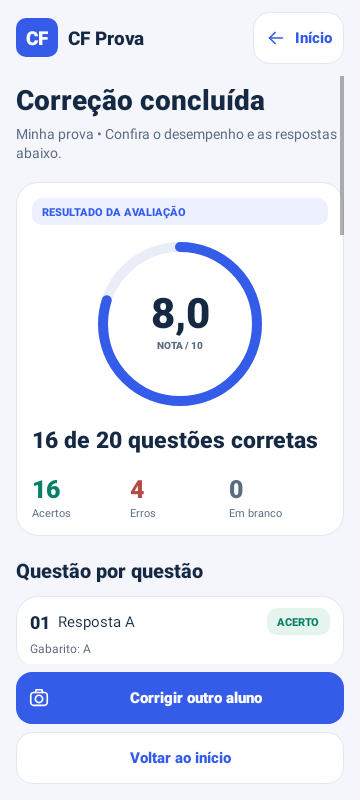

# CF Prova

App Android para corrigir cartões de respostas a partir de uma **foto tirada dentro do app**, disponível somente para conferência. A foto fica apenas na memória: não é salva na galeria, em arquivo temporário ou enviada para servidores. O app funciona offline.

## Visual e navegação

A versão 0.5.0 traz cartões de etapas, botões de ação destacados e acesso fixo à câmera na tela inicial. O gabarito usa botões A–E com seleção visível; salvar e concluir ficam sempre acessíveis na parte inferior. A câmera tem uma guia visual para enquadrar o cartão, e a conferência reúne foto ampliável, acertos, nota e indicação de acerto/erro por questão. O resultado final inclui uma nota circular e a divisão entre acertos, erros e questões em branco.

  

[Prévia da câmera](docs/visual/camera.png) · [Prévia da conferência](docs/visual/conferencia.png). As imagens são renderizações de interface em ambiente Android simulado; a prévia de câmera está sem câmera conectada e a conferência usa um cartão ilustrativo. Foram conferidas larguras de 320 e 360 dp e fonte ampliada a 140%. Isso não substitui os testes físicos da câmera.

## Como usar

1. Defina o nome e a quantidade de questões (5 a 40).
2. Edite e salve o gabarito do professor (A–E). As respostas começam em A: confira todas antes de corrigir.
3. Gere o **Word editável (.docx)** ou o **PDF**: um único cartão no canto superior esquerdo de uma A4, ocupando menos de 1/4 da página. No Word, personalize instituição, professor e avaliação. Imprima em A4, a 100%, preservando marcadores e código.
4. O aluno preenche uma bolha inteira por questão, com caneta escura.
5. Toque em **Fotografar cartão**, permita acesso à câmera e enquadre um cartão v2 inteiro, na vertical, com o quadrado maior no alto à esquerda. Use boa luz; toque na prévia para ajustar o foco.
6. Toque em **Tirar foto**. A tela de conferência mostra a foto, **X acertos de N questões**, a nota e as respostas reconhecidas. Se a foto não permitir uma leitura confiável, o app explica o problema e permite refazer, sem atribuir nota.
7. Toque na foto para ampliar; use dois dedos para aproximar e arraste. Confira cada resposta com a imagem e com o gabarito. Se necessário, ajuste as alternativas na lista: acertos e nota são atualizados imediatamente.
8. Use **Refazer foto** para refazer ou **Concluir conferência** para ver o resultado final sem a imagem. **Sair e descartar** cancela a correção.
9. Para o próximo aluno, toque em **Corrigir outro aluno**.

Respostas em branco valem zero. Marcas fracas ou duplas impedem a leitura automática da foto: corrija o preenchimento ou melhore o enquadramento e refaça. Questões têm o mesmo peso e a nota vai de 0 a 10.

## Foto e privacidade

A captura usa o callback em memória do CameraX (`OnImageCapturedCallback`), sem `OutputFileOptions`, URI de arquivo ou MediaStore. A foto não é compartilhada entre atividades, serializada em estado salvo nem mantida em variável estática. A tela de câmera/conferência bloqueia capturas de tela e miniaturas no seletor de aplicativos com `FLAG_SECURE`.

A imagem é liberada ao refazer a captura, finalizar, cancelar, sair da tela ou colocar o aplicativo em segundo plano. Uma captura atrasada que chega depois de sair é rejeitada e liberada. Se a tela de conferência for interrompida ou recriada, será necessário tirar outra foto; a imagem não é restaurada de disco. A câmera é liberada durante a conferência. Só as respostas conferidas voltam para a tela de resultado.

O gabarito do professor continua salvo no aparelho. Os arquivos Word/PDF exportados também podem existir no cache; eles são modelos em branco e não contêm a foto do aluno.

## Desenvolvimento

Requisitos: JDK 17 ou 21, Android SDK Platform 35 e Build Tools 35.0.0. Configure `ANDROID_HOME` ou `sdk.dir` no arquivo local ignorado `local.properties`.

```sh
./gradlew testDebugUnitTest lintDebug assembleDebug
```

Na nuvem preparada: `/workspace/tooling/cf-gradle testDebugUnitTest lintDebug assembleDebug`.

APK: `app/build/outputs/apk/debug/app-debug.apk`. Android 8.0 ou posterior, com câmera traseira. Compilação de desenvolvimento, sem assinatura de publicação.

## Testes e APK pelo GitHub

O GitHub Actions executa os testes, a análise estática e gera o APK em cada envio à `main` e em pull requests. Para iniciar manualmente, abra **Actions → Android — testes e APK → Run workflow**.

Após uma execução bem-sucedida, baixe **CF-Prova-Android-debug** em **Artifacts** (disponível por 14 dias), extraia o ZIP e abra `app-debug.apk` no celular. Autorize a instalação dessa origem quando solicitado. É necessário estar conectado ao GitHub para baixar artefatos.

Se houver outra versão assinada com uma chave diferente, o Android pode recusar a atualização. Desinstalar a anterior apaga o gabarito salvo. Evite desinstalar se a atualização funcionar.

## Validação no celular

Gere um cartão v2 de cinco questões, preencha quatro corretamente e uma incorretamente. Abra a câmera, toque em **Tirar foto** e confira o resultado **4 acertos de 5 questões**, nota **8,0**, junto da imagem. Confira o zoom e o ajuste manual das respostas; ajustar a resposta errada para a correta deve atualizar para cinco acertos e nota 10.

Verifique também: refazer a foto; finalizar a conferência; sair ou colocar o app em segundo plano durante a captura/conferência; voltar e confirmar que a foto anterior não está disponível; conferir que nenhuma imagem foi criada na galeria. Teste respostas em branco, marcas duplas, cartão ausente ou invertido, quantidade de questões divergente, sombras, foco e recusa da permissão.

Os testes automatizados cobrem classificação, contagem de acertos, correção de respostas, imagens sintéticas do cartão, perspectiva, códigos e descarte de imagens transitórias, incluindo callbacks atrasados. Não substituem testes físicos da câmera, do descarte no Android e dos cartões impressos. Essa validação em um aparelho real ainda precisa ser feita.

## Modelo compacto para qualquer instituição

A exportação mantém **um cartão de 1/4 de página** em uma A4, no canto superior esquerdo; o restante fica em branco. A área óptica mede **87 × 130,5 mm**, com cabeçalho editável acima, dentro de aproximadamente **100 × 142,9 mm**. Cabe em um quarto da A4 (105 × 148,5 mm), com margens de impressão. O modelo não tem instituição fixa.

[Baixar modelo Word de 20 questões](modelos/cartao-20-questoes.docx). Para outra quantidade, use a exportação do aplicativo (5 a 40). É Word moderno `.docx`.

Edite os três campos do cabeçalho, mantendo as três linhas. A grade óptica é uma imagem fixa; preserve bolhas, marcadores, código e proporções. O aluno preenche nome, turma e data à mão. Para alterar a quantidade de questões, gere o cartão novamente. O código identifica formato e quantidade, não o nome da prova: escolha o gabarito correto no app.

Imprima em A4, a 100%, e aproxime a câmera de um cartão por vez. Especialmente com 40 questões, valide a impressão e o foco. O leitor continua usando a geometria v2; a mudança para captura por botão não exige trocar cartões v2 existentes. Não há contas, histórico de alunos, pesos individuais ou exportação de notas.
